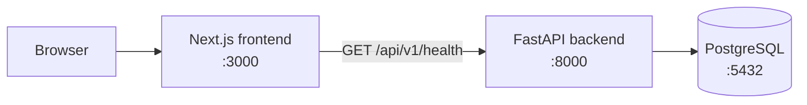
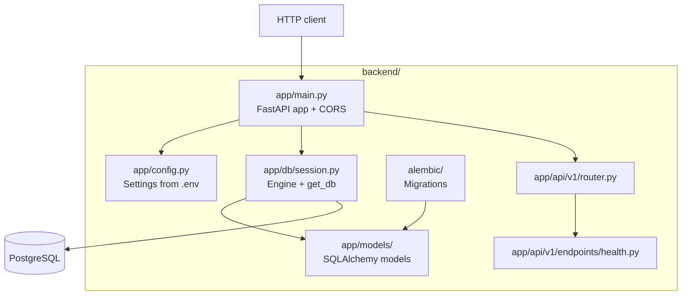
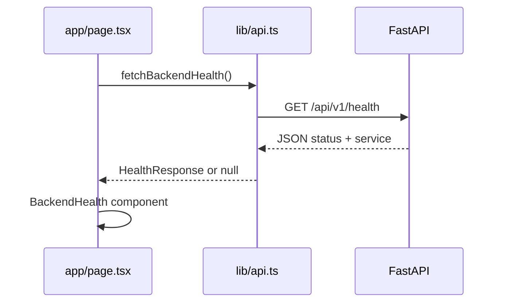
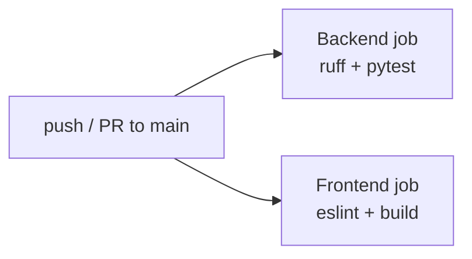

# FastStack architecture

FastStack is a monorepo with two deployable apps: a Python API and a Next.js web UI. They communicate over HTTP with CORS enabled for browser requests during local development.

## High-level view

## Backend (FastAPI + uv)

### Versioned routes

All public API routes for version 1 live under the configurable prefix (default **`/api/v1`**). New breaking versions can be added as `app/api/v2/` without changing existing clients.

| Method | Path              | Purpose                          |
|--------|-------------------|----------------------------------|
| GET    | `/api/v1/health`  | Liveness / connectivity check    |

OpenAPI is auto-generated at `/docs` and `/openapi.json`.

### Configuration

[`app/config.py`](backend/app/config.py) loads settings from environment variables and optional `backend/.env` via Pydantic Settings. CORS origins are parsed from a comma-separated list so multiple frontends (e.g. staging URLs) can be allowed.

### Database (phase 2)

- **Engine & sessions** — [`app/db/session.py`](backend/app/db/session.py) creates a SQLAlchemy engine from `DATABASE_URL` and exposes `get_db()` for FastAPI dependencies (request-scoped session, always closed in `finally`).
- **Models** — [`app/models/`](backend/app/models/) defines tables (currently `User`: email, hashed password, timestamps). Import models in Alembic `env.py` so autogenerate sees metadata.
- **Migrations** — Run `uv run alembic upgrade head` after pulling schema changes. Revision scripts live in [`alembic/versions/`](backend/alembic/versions/).
- **Tests** — Integration tests under `tests/integration/` use a real PostgreSQL instance (`DATABASE_URL`). Each test runs in a rolled-back transaction for isolation. CI provides Postgres as a service container.

## Frontend (Next.js)

The home page is a **Server Component** that calls the backend during render (`cache: "no-store"` so status stays fresh in dev). If the API is down, the UI shows **Unavailable** and hints to start the backend.

API base URL comes from **`NEXT_PUBLIC_API_URL`** (see `frontend/.env.example`).

## CI pipeline

GitHub Actions runs both jobs in parallel on every push and pull request to `main`.

## Adding features

1. **New API endpoint** — Add a module under `backend/app/api/v1/endpoints/`, register it on `api_router` in `backend/app/api/v1/router.py`, inject `Session` via `Depends(get_db)`, add tests under `backend/tests/`.
2. **New table** — Add a model in `app/models/`, import it in `app/models/__init__.py`, run `alembic revision --autogenerate`, review the migration, then `alembic upgrade head`.
3. **New page or UI** — Add routes under `frontend/app/`; call the API through helpers in `frontend/lib/`.
4. **New API version** — Copy the `v1` package to `v2`, mount with `app.include_router(..., prefix="/api/v2")` in `main.py`.

Keep health checks cheap and unauthenticated so load balancers and the starter UI can use them without extra setup.
